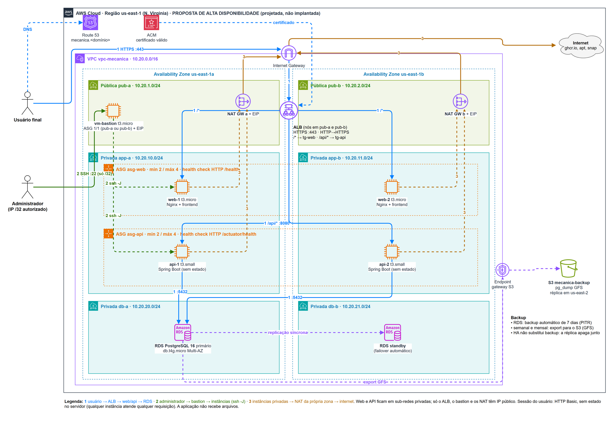

# Alta disponibilidade (Parte C)

**É só uma proposta, não foi implantada.** O que está implantado é a arquitetura de [`diagramas/arquitetura.png`](diagramas/arquitetura.png). Decisão registrada no [ADR-004](adr/004-estrategia-de-alta-disponibilidade.md).

Arquivo editável: [`diagramas/arquitetura-ha.drawio`](diagramas/arquitetura-ha.drawio)

## O que muda, em resumo

- **Zonas:** de 1 para **2** (`us-east-1a` e `us-east-1b`).
- **Entrada:** sai a `vm-web` com IP público e entra um **Load Balancer (ALB)** com HTTPS.
- **Web e API:** em vez de 1 VM cada, **2 instâncias de cada** (uma por zona), em grupos de autoescalonamento.
- **Banco:** sai o PostgreSQL dentro da VM e entra o **RDS Multi-AZ**, com uma cópia pronta na outra zona.
- **NAT:** de 1 para **1 por zona**.
- **Bastion:** continua 1, mas é recriado automaticamente se cair.

## H1. Duas zonas e novas sub-redes

A VPC continua `10.20.0.0/16`. A zona `b` ganha sub-redes iguais às da zona `a`:

- **Públicas** (Load Balancer, NAT, bastion): `pub-a` 10.20.1.0/24 e `pub-b` 10.20.2.0/24.
- **Aplicação** (web e API): `app-a` 10.20.10.0/24 (a antiga `priv-a`) e `app-b` 10.20.11.0/24.
- **Banco** (RDS): `db-a` 10.20.20.0/24 e `db-b` 10.20.21.0/24.

Rotas:
- As públicas saem pelo Internet Gateway.
- As privadas da zona `a` saem pelo NAT `a`, e as da zona `b`, pelo NAT `b`.
- O tráfego para o S3 vai pelo endpoint, sem passar pelo NAT.

## H2. Load Balancer e autoescalonamento

- **ALB** nas duas zonas:
  - porta **443** com certificado válido do ACM;
  - a porta 80 só redireciona para a 443;
  - `/api/*` vai para as instâncias da API e o resto vai para as da web.
- **`asg-web`:** de 2 a 4 instâncias `t3.micro`.
  - Health check: `GET /health`, que já existe no Nginx.
- **`asg-api`:** de 2 a 4 instâncias `t3.small`.
  - Health check: `GET /actuator/health`. Para isso a aplicação precisa ganhar a dependência `spring-boot-starter-actuator`.
- Uma instância que falhar no health check é **substituída automaticamente**.
- Se a CPU média passar de 60%, o grupo cria mais instâncias.
- As instâncias só aceitam tráfego vindo do ALB (e SSH vindo do bastion). O banco só aceita conexões da API.

## H3. NAT: um por zona

**Escolha: um NAT em cada zona.** Custa o dobro: US$ 65,70 em vez de US$ 32,85 por mês.

**Motivo:** se uma zona cair, o autoescalonamento cria instâncias novas na outra, e elas precisam baixar pacotes e imagens pela internet no boot. Com um NAT só, se a zona perdida fosse a dele, as instâncias novas não subiriam, e a alta disponibilidade falharia justamente quando fosse necessária.

## H4. Banco: RDS Multi-AZ

**Escolha: RDS PostgreSQL 16 (`db.t4g.micro`) Multi-AZ.**
- Cada gravação é confirmada nas duas zonas, então **não se perde dado** se uma zona cair.
- Se o banco principal cair, a AWS troca para a cópia em **60 a 120 segundos**, sem mudar o endereço.
- Tem backup automático de 7 dias, criptografia e nenhum acesso público.

**Descartadas:**
- **PostgreSQL em duas VMs:** a troca seria manual ou exigiria ferramentas extras.
- **Réplica de leitura:** é assíncrona e a promoção é manual.
- **Banco dentro da VM:** impede ter duas APIs.

Se a proposta fosse implantada, esta escolha substituiria o [ADR-003](adr/003-localizacao-banco.md).

## H5. Nenhum estado dentro das instâncias

- **Dados:** no RDS.
- **Sessão:** não existe sessão no servidor. O login é HTTP Basic, e o navegador envia usuário e senha em cada requisição, então qualquer instância atende qualquer usuário.
- **Arquivos enviados:** a aplicação não tem upload. Se tiver um dia, os arquivos vão para o S3.
- **Senhas:** no SSM Parameter Store.
- **Logs:** no CloudWatch, para não sumirem quando uma instância for trocada.

Por isso as instâncias são **descartáveis**: podem ser criadas e destruídas a qualquer hora sem perder nada.

## H6. Pontos únicos de falha da Entrega 1 (seção 5.10)

1. **Tudo em uma zona:** eliminado, agora são 2 zonas.
2. **API e banco na mesma VM:** eliminado, com API em grupo e banco no RDS.
3. **Uma só VM web:** eliminado, com o ALB e 2 instâncias.
4. **Um só NAT:** eliminado, com 1 NAT por zona.
5. **Um só bastion:** **aceito.** Se cair, é recriado em 3 a 5 minutos. Um segundo bastion custaria mais uma VM só para o acesso dos administradores, sem afetar os usuários.
6. **Sem HTTPS:** eliminado. Já corrigido nesta entrega, e na proposta o certificado passa a ser válido.
7. **IP residencial que muda:** **aceito.** Não afeta a aplicação; basta atualizar a regra com `terraform apply`.
8. **CPU com créditos (T3):** **reduzido.** Quando a CPU sobe, o grupo cria mais instâncias.

**Continuam existindo:**
- **Falha da região inteira:** derruba tudo. Usar duas regiões dobraria custo e complexidade, mas o backup tem cópia em outra região.
- **Troca de banco no RDS:** são de 60 a 120 segundos de erro.

## H7. Fluxos na nova arquitetura

1. **Usuário:** navegador → domínio no Route 53 → **ALB (443)** → instância web ou API saudável em qualquer zona → a API consulta o **RDS**.
2. **Administrador:** IP do integrante → **bastion (22)** → `ssh -J` para qualquer instância. O RDS não tem SSH; é acessado com `psql` a partir do bastion.
3. **Saída para a internet:** instância da zona `a` → **NAT a**; instância da zona `b` → **NAT b**. O tráfego para o S3 vai pelo endpoint.

## Custo

**US$ 191,25 por mês, contra US$ 77,27 da arquitetura atual: +147%.**
- Estimativa na calculadora da AWS: <https://calculator.aws/#/estimate?id=f086b12b671f516ba6cde44f558dc4bf36a23e06>
- PDF: [`custos/estimativa-alta-disponibilidade.pdf`](custos/estimativa-alta-disponibilidade.pdf)
- Item a item: [`custos/custo-alta-disponibilidade.csv`](custos/custo-alta-disponibilidade.csv)

**De onde vêm os US$ 114 a mais por mês:**
1. Segundo NAT: +US$ 32,85.
2. RDS Multi-AZ: +US$ 27,96 (paga duas instâncias e dois discos).
3. Instâncias extras: +US$ 23,10.
4. Load Balancer: +US$ 22,27 (cobra por hora, mesmo sem uso).
5. IPs públicos: +US$ 7,30 (5 em vez de 3).
6. Route 53: +US$ 0,50.

Fora da conta: o domínio, cerca de US$ 14 por ano.

**Vale a pena para a oficina? Não.**
- São até 10 usuários, só em horário comercial e sem SLA. Se o sistema cair, a oficina anota no papel e lança depois.
- Falha de zona é rara. Com o backup, recriamos tudo em outra zona em menos de 1 hora, dentro do RTO de 4 horas.
- Pagar **US$ 1.368 a mais por ano** para evitar poucas horas paradas não compensa.
- **Vale adotar já:** o backup GFS com cópia em outra região (US$ 1,22 por ano) e o certificado válido.
- A proposta passa a valer a pena se a oficina virar uma rede ou abrir agendamento online para clientes.
