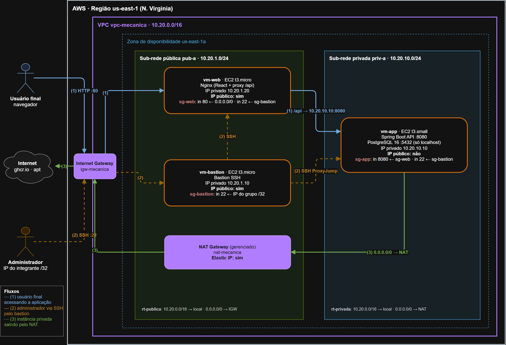

# Arquitetura

> Entrega 1 — Projeto de Arquitetura e Decisões de Infraestrutura.
> Provedor: **AWS** · Região: **us-east-1 (N. Virginia)** · Zona: **us-east-1a**

## 5.1 Descrição da aplicação

**Problema.** Oficinas mecânicas pequenas controlam serviços em papel ou planilha: não sabem quais serviços estão pendentes, qual mecânico está responsável por cada um nem quanto cada serviço vai custar.

**Usuários.** Funcionários administrativos da oficina (cadastram e acompanham serviços) e o administrador do sistema.

**Funcionalidades principais.**

- Login (HTTP Basic, usuário administrador criado automaticamente no primeiro start).
- Cadastro, listagem, edição e exclusão de **mecânicos** (nome, especialidade, telefone, e-mail, ativo/inativo).
- Cadastro, listagem, edição e exclusão de **serviços** (ordens de serviço): descrição, carro, mecânico responsável, valor, duração estimada e status (pendente, em andamento, concluído).

**Componentes técnicos.**

| Componente | Tecnologia | Exposto à internet? |
|---|---|---|
| Frontend | SPA React (Vite) servida por Nginx, que também faz proxy de `/api` para o backend | **Sim** (porta 80) |
| Backend | API REST Spring Boot 3.5 (Java 17), porta 8080 | Não — só recebe tráfego do Nginx |
| Banco de dados | PostgreSQL 16, porta 5432 | Não — só acessível pela API, na mesma VM |

**Requisitos não funcionais assumidos.**

| Requisito | Valor assumido |
|---|---|
| Usuários simultâneos | até 10 (uma oficina pequena) |
| Volume de dados | menos de 1 GB no primeiro ano |
| Disponibilidade esperada | horário comercial, sem SLA formal |
| Alta disponibilidade | **Não oferecida.** Uma única zona, uma instância por camada e nenhuma redundância (ver 5.10) |
| Backup | Não automatizado nesta entrega (plano de backup na Entrega 2) |

## 5.2 Diagrama de arquitetura

Fonte editável: [`diagramas/arquitetura.drawio`](diagramas/arquitetura.drawio) · Imagem: [`diagramas/arquitetura.png`](diagramas/arquitetura.png)

**Fluxos numerados**

1. **Usuário final acessando a aplicação:** navegador → Internet Gateway → `vm-web` (porta 80, IP público) → Nginx entrega o React. Chamadas a `/api/*` são repassadas pelo Nginx para `vm-app:8080` (IP privado) → a API consulta o PostgreSQL em `localhost:5432`.
2. **Administrador acessando via SSH:** máquina do integrante (IP /32 liberado) → Internet Gateway → `vm-bastion:22` → a partir do bastion, SSH para `vm-web` ou `vm-app` pelo IP privado (`ssh -J` / ProxyJump).
3. **Instância privada acessando a internet:** `vm-app` → rota `0.0.0.0/0` da sub-rede privada → NAT Gateway (sub-rede pública) → Internet Gateway → internet (atualizações do sistema com `apt` e download das imagens Docker em `ghcr.io`). Conexões iniciadas pela internet não conseguem entrar por esse caminho.

## 5.3 Plano de endereçamento IP

| Recurso | Nome | CIDR | Zona | Tipo | Finalidade |
|---|---|---|---|---|---|
| Rede virtual | `vpc-mecanica` | `10.20.0.0/16` | - | - | Rede do projeto |
| Sub-rede | `pub-a` | `10.20.1.0/24` | us-east-1a | Pública | Bastion, web (Nginx), NAT Gateway |
| Sub-rede | `priv-a` | `10.20.10.0/24` | us-east-1a | Privada | Aplicação (API + PostgreSQL) |

**IPs privados fixos das instâncias.** Definidos no Terraform (`private_ip`), para que o Nginx aponte para um endereço estável do backend mesmo após recriar o ambiente.

| Instância | Sub-rede | IP privado | IP público |
|---|---|---|---|
| `vm-bastion` | `pub-a` | 10.20.1.10 | Sim (IPv4 público da AWS) |
| `vm-web` | `pub-a` | 10.20.1.20 | Sim (IPv4 público da AWS) |
| NAT Gateway | `pub-a` | atribuído pela AWS | Sim (Elastic IP) |
| `vm-app` | `priv-a` | 10.20.10.10 | **Não** |

**Justificativa dos tamanhos.**

- **VPC /16:** 65.536 endereços, o maior bloco permitido pela AWS. Não custa nada a mais e deixa espaço para novas sub-redes sem renumerar a rede. Na Entrega 2, a proposta de alta disponibilidade pode acrescentar `10.20.2.0/24` (pública) e `10.20.11.0/24` (privada) em `us-east-1b`.
- **Sub-redes /24:** 256 endereços, dos quais a AWS **reserva 5 em cada sub-rede** (rede, roteador da VPC, DNS, reservado para uso futuro e broadcast). Sobram **251 utilizáveis**, muito mais que as 2 ou 3 interfaces de cada sub-rede. Um /28 (11 utilizáveis) bastaria hoje, mas o /24 deixa as contas simples e acomoda crescimento (mais instâncias ou um balanceador) sem recriar a sub-rede.
- **Numeração:** públicas em `10.20.1-9.x` e privadas em `10.20.10-19.x`. O terceiro octeto já indica o tipo da sub-rede.
- Todas as faixas são privadas (RFC 1918) e não se sobrepõem.

**Endereços reservados em `10.20.1.0/24` (mesma lógica em `priv-a`):**

| Endereço | Uso pela AWS |
|---|---|
| 10.20.1.0 | Endereço de rede |
| 10.20.1.1 | Roteador da VPC |
| 10.20.1.2 | Servidor DNS da AWS |
| 10.20.1.3 | Reservado para uso futuro |
| 10.20.1.255 | Broadcast (não suportado, mas reservado) |

## 5.4 Tabelas de rota

**`rt-publica`** — associada a `pub-a`

| Destino | Alvo | Motivo |
|---|---|---|
| `10.20.0.0/16` | local | Comunicação interna da VPC (criada automaticamente) |
| `0.0.0.0/0` | Internet Gateway (`igw-mecanica`) | É o que torna a sub-rede **pública**: entrada e saída direta para a internet |

**`rt-privada`** — associada a `priv-a`

| Destino | Alvo | Motivo |
|---|---|---|
| `10.20.0.0/16` | local | Comunicação interna da VPC (Nginx → API, bastion → app) |
| `0.0.0.0/0` | NAT Gateway (`nat-mecanica`) | Saída para a internet **só de dentro para fora** |

**E se a rota `0.0.0.0/0 → NAT` não existisse?** A `vm-app` continuaria funcionando para quem já está dentro da VPC (o Nginx e o bastion alcançam ela pela rota `local`), mas ficaria **sem nenhuma saída para a internet**:

- o `apt update` e a instalação de pacotes falhariam;
- não seria possível baixar as imagens Docker do `ghcr.io`, então o cloud-init falharia e a aplicação nem subiria numa recriação do ambiente.

Os pacotes para a internet seriam descartados por falta de rota, e as conexões dariam *timeout*.

## 5.5 Matriz de regras de segurança

Três grupos de segurança, um por função. Regras entre componentes internos referenciam **outro grupo de segurança**, e não faixas de IP. Como os grupos de segurança da AWS são *stateful*, o tráfego de resposta é liberado automaticamente.

| Grupo de segurança | Direção | Protocolo | Porta | Origem/Destino | Justificativa |
|---|---|---|---|---|---|
| `sg-bastion` | Entrada | TCP | 22 | IP de cada integrante (/32) | Acesso administrativo. Único ponto de entrada SSH. **Nunca `0.0.0.0/0`** |
| `sg-bastion` | Saída | TCP | 22 | `sg-web` | Saltar do bastion para a VM web |
| `sg-bastion` | Saída | TCP | 22 | `sg-app` | Saltar do bastion para a VM da aplicação |
| `sg-web` | Entrada | TCP | 80 | `0.0.0.0/0` | Usuários finais acessam o site (fluxo 1) |
| `sg-web` | Entrada | TCP | 22 | `sg-bastion` | SSH só via bastion |
| `sg-web` | Saída | TCP | 8080 | `sg-app` | Nginx repassa `/api` para o backend |
| `sg-web` | Saída | TCP | 443 | `0.0.0.0/0` | Download de pacotes e imagens Docker (HTTPS) |
| `sg-web` | Saída | TCP | 80 | `0.0.0.0/0` | Repositórios `apt` do Ubuntu (HTTP) |
| `sg-app` | Entrada | TCP | 8080 | `sg-web` | API só aceita chamadas do Nginx |
| `sg-app` | Entrada | TCP | 22 | `sg-bastion` | SSH só via bastion |
| `sg-app` | Saída | TCP | 443 | `0.0.0.0/0` | Imagens Docker (`ghcr.io`) via NAT (fluxo 3) |
| `sg-app` | Saída | TCP | 80 | `0.0.0.0/0` | Repositórios `apt` do Ubuntu via NAT |

**Observações.**

- **PostgreSQL (5432) não tem regra nenhuma.** O banco roda na mesma VM da API e escuta apenas em `localhost`, então nenhuma interface de rede aceita conexões na 5432. Um grupo `sg-db` seria criado se o banco fosse separado (ver [ADR 003](adr/003-localizacao-banco.md)).
- A regra de saída padrão da AWS ("tudo liberado") é **removida** e substituída pelas saídas acima (menor privilégio).
- As *Network ACLs* ficam no padrão (tudo liberado). O controle é feito nos grupos de segurança, que são *stateful* e mais fáceis de manter.
- HTTPS (443) de entrada não é oferecido nesta versão, porque o projeto não tem domínio próprio nem certificado (ver 5.10).

## 5.6 Tecnologias

| Camada | Tecnologia | Versão | Justificativa |
|---|---|---|---|
| Provedor e região | AWS `us-east-1` (N. Virginia) | - | Ver justificativa abaixo |
| Sistema operacional | Ubuntu Server LTS | 24.04 | LTS com suporte até 2029, AMI oficial gratuita, compatível com cloud-init |
| Contêineres | Docker Engine + Docker Compose | estável do repositório oficial | A aplicação já possui Dockerfiles e imagens publicadas no `ghcr.io`. O mesmo artefato roda local e na nuvem |
| Runtime / linguagem (backend) | Java (Eclipse Temurin JRE) + Spring Boot | 17 / 3.5.16 | Stack já usada na aplicação. Java 17 é LTS |
| Runtime / build (frontend) | Node.js + React + Vite | 22 / 19.2 / 8.1 | Node só é usado no build da imagem. Em produção sobram arquivos estáticos |
| Servidor web / proxy | Nginx | `nginx:alpine` (estável) | Serve os arquivos do React e faz *reverse proxy* de `/api` para o backend, o que evita expor a porta 8080 |
| Banco de dados | PostgreSQL | 16 (`postgres:16-alpine`) | Já usado pela aplicação, relacional, com suporte a JPA/Hibernate |
| Infraestrutura como código | Terraform | ≥ 1.9 | Exigido pela disciplina. Permite `apply`/`destroy` repetíveis (ver 5.9) |
| Provider do Terraform | `hashicorp/aws` | `~> 6.0` | Provider oficial da AWS |
| Instalação da aplicação | cloud-init (`user_data`) | - | A VM instala Docker e sobe a aplicação sozinha no primeiro boot. Necessário para destruir e recriar o ambiente sem trabalho manual |

**Justificativa do provedor e da região.**

- **Custo:** `us-east-1` é a região mais barata da AWS. As mesmas instâncias e o NAT Gateway custam cerca de 50–60% mais em `sa-east-1` (São Paulo). Como o custo é pago pelo grupo, este foi o critério decisivo.
- **Latência:** ~120 ms do Brasil até `us-east-1`, contra ~20 ms em São Paulo. Para um sistema administrativo usado por poucas pessoas, sem tempo real, essa diferença é aceitável.
- **Disponibilidade dos serviços:** `us-east-1` oferece todos os serviços necessários na Entrega 2 (VPC, NAT Gateway, EC2 T3, Elastic IP, AWS Budgets) e possui 6 zonas de disponibilidade, o que permite propor alta disponibilidade depois.
- **Familiaridade:** o grupo já usou AWS em trabalhos anteriores (EC2, VPC, Lambda).

## 5.7 Dimensionamento das instâncias

| Componente | Família | Tipo | vCPU | Memória | Disco (tipo e tamanho) | Sub-rede | Justificativa |
|---|---|---|---|---|---|---|---|
| Bastion (`vm-bastion`) | T3 (CPU baseada em créditos) | `t3.micro` | 2 | 1 GiB | gp3, 8 GiB | `pub-a` | Só encaminha conexões SSH. Não processa nada. É o menor tipo T3 com 1 GiB, suficiente para o Ubuntu |
| Web (`vm-web`) | T3 (CPU baseada em créditos) | `t3.micro` | 2 | 1 GiB | gp3, 8 GiB | `pub-a` | Nginx servindo arquivos estáticos usa menos de 50 MB de RAM. Para 10 usuários, a CPU fica ociosa quase o tempo todo |
| Aplicação + banco (`vm-app`) | T3 (CPU baseada em créditos) | `t3.small` | 2 | 2 GiB | gp3, 20 GiB | `priv-a` | Spring Boot usa ~400–600 MB, PostgreSQL ~150–250 MB, e o sistema com Docker mais ~300 MB, ou seja ~1,2 GB no pico. O disco maior guarda as imagens Docker e os dados do banco |

**Por que família T3 (baseada em créditos).** A carga da seção 5.1 (até 10 usuários, uso em horário comercial) é baixa e intermitente: a CPU fica ociosa quase sempre e tem picos curtos, como a inicialização do Spring ou uma listagem. É o perfil para o qual as instâncias com crédito foram feitas: pagar uma fração do custo de uma instância de uso geral (M) e acumular créditos enquanto ociosa.

**Por que não um tamanho menor.**

- `t3.nano` (0,5 GiB) não comporta o Ubuntu com Docker com folga, e o bastion e a web ficariam no limite. A economia seria de ~US$ 0,005/h.
- Para a `vm-app`, uma `t3.micro` (1 GiB) não comporta Spring Boot + PostgreSQL. Faltaria memória e o sistema começaria a matar processos (OOM killer) ou usar *swap*, deixando a API lenta ou fora do ar.

**O que acontece quando os créditos acabam.** Cada T3 tem uma linha de base de uso de CPU (10% por vCPU na `t3.micro`, 20% na `t3.small`). Acima disso, ela gasta créditos acumulados. Vamos usar o **modo `standard`**: quando os créditos acabam, a CPU é **limitada à linha de base**, e a aplicação continua no ar, só que lenta (respostas da API demoram mais e a inicialização do Spring fica mais longa). Escolhemos `standard` em vez do padrão `unlimited` porque no `unlimited` o uso acima da base é **cobrado à parte**, o que poderia gerar custo inesperado para o grupo.

## 5.9 Estimativa de custos

> Estimativa oficial (AWS Pricing Calculator, exportada em 01/10/2026):
> - Link: <https://calculator.aws/#/estimate?id=9e7fbfad8f04a4509955794e7fb70ace1189658c>
> - Exportação: [`custos/estimativa.pdf`](custos/estimativa.pdf)
>
> Região `us-east-1`, preços on-demand, sem nível gratuito.

**Itens de custo (valores da calculadora)**

| Linha da calculadora | Configuração | Mensal (730 h) |
|---|---|---|
| Amazon EC2 · `vm-bastion` | `t3.micro` Linux on-demand + EBS gp3 8 GB | US$ 8,23 |
| Amazon EC2 · `vm-web` | `t3.micro` Linux on-demand + EBS gp3 8 GB | US$ 8,23 |
| Amazon EC2 · `vm-app` | `t3.small` Linux on-demand + EBS gp3 20 GB | US$ 16,78 |
| Amazon VPC · `rede-vpc` | 1 NAT Gateway + 5 GB processados + 3 IPv4 públicos em uso | US$ 44,03 |
| **Total** | | **US$ 77,27** |

O item da VPC se decompõe, pelos preços públicos da região, em: NAT Gateway por hora (730 h × US$ 0,045 = **US$ 32,85**), dados processados pelo NAT (5 GB × US$ 0,045 = US$ 0,23) e IPv4 público (3 × 730 h × US$ 0,005 = US$ 10,95). A transferência de saída para a internet é desprezível (os primeiros 100 GB/mês são gratuitos).

> Observação: o resumo exportado lista "Regional NAT Gateways (1)" porque o campo da calculadora não aceita zero, mas o valor da VPC (US$ 44,03 = 32,85 + 0,23 + 10,95) mostra que só o NAT Gateway comum foi cobrado. A arquitetura usa um NAT Gateway zonal, em `us-east-1a`.

**Cenários**

| Cenário | Premissa | Custo estimado |
|---|---|---|
| **A: operação contínua** | Tudo ligado 24 h × 730 h/mês | **US$ 77,27/mês** (US$ 927,24 em 12 meses) |
| **B: trabalho (Entrega 2)** | ~40 h ligados até 23/11 (≈ 12 sessões de 3 h + apresentação), com `terraform destroy` entre as sessões | **~US$ 4,23 no período** |

Cálculo do cenário B: a calculadora estima 730 h/mês, então o custo por hora com tudo ligado é US$ 77,27 ÷ 730 = **US$ 0,1059/h**. Multiplicando por 40 h, dá **≈ US$ 4,23**. Como o ambiente é destruído entre as sessões, discos, IPs e NAT só existem (e só são cobrados) nessas horas.

**Item mais caro: NAT Gateway (US$ 32,85 + dados, ~43% do custo mensal).** Ele custa praticamente o mesmo que as três VMs juntas (US$ 33,24, já com os discos) e cobra por hora mesmo sem tráfego.

- **Como reduzir:** substituir por uma **instância NAT** (`t4g.nano`, ~US$ 3/mês) com *source/dest check* desativado, ou remover a saída da sub-rede privada e usar uma imagem de VM com tudo pré-instalado.
- **O que se perde:** a instância NAT é mais um servidor para atualizar e proteger, vira um ponto único de falha sem recuperação automática e tem banda limitada ao tamanho da instância. Sem saída, perdemos as atualizações de segurança e o download das imagens. Como o NAT gerenciado é **obrigatório** na Entrega 2, a redução não será aplicada (ver [ADR 002](adr/002-saida-internet-subrede-privada.md)).

**Nível gratuito.** **A estimativa não considera nenhum nível gratuito**, ou seja, é o pior caso. Contas AWS criadas depois de 15/07/2025 recebem créditos promocionais em vez das antigas 750 h/mês gratuitas de `t2/t3.micro`, e qualquer crédito disponível na conta do grupo só reduz o valor pago. O NAT Gateway e o IPv4 público não são cobertos pelo nível gratuito em nenhum caso. _(Se o grupo confirmar créditos em Billing → Free Tier / Credits, registrar aqui o valor.)_

**Plano de controle de custos**

| Medida | Como |
|---|---|
| Destruir o ambiente entre as sessões | `terraform destroy` ao fim de **toda** sessão de trabalho. Nunca deixar ligado de um dia para o outro |
| Alerta de orçamento | AWS Budgets: orçamento mensal de **US$ 15** com alertas por e-mail para os 3 integrantes em 50%, 80% e 100% (real e previsto) |
| Tags em todos os recursos | `Projeto = projeto-integrador-cloud`, `Grupo = mecanica`, `Ambiente = entrega2`, `Responsavel = <integrante>`, aplicadas via `default_tags` do provider. Permitem filtrar o custo no Cost Explorer |
| Verificação de sobras | Ao fim de cada sessão, conferir no console (EC2 e VPC → NAT Gateways / Elastic IPs) se nada ficou para trás |

**Estratégia diante do trade-off custo × esforço.** Destruir e recriar o ambiente reduz o custo a só as horas usadas, mas sem automação exigiria reinstalar tudo à mão a cada sessão. **Adotamos destruir e recriar, com instalação automatizada via cloud-init**: o Terraform cria as VMs e cada uma instala o Docker e sobe a aplicação no primeiro boot, em poucos minutos e sem intervenção. O preço aceito é o esforço inicial de escrever e testar os scripts, e o fato de que **os dados do banco se perdem a cada `destroy`**. Isso é aceitável porque são dados de teste, e o usuário administrador é recriado automaticamente pela aplicação.

## 5.10 Riscos e limitações

| # | Ponto único de falha / limitação | Impacto |
|---|---|---|
| 1 | **Tudo em uma única zona de disponibilidade** (`us-east-1a`) | Uma falha da zona derruba a aplicação inteira, sem recuperação até a zona voltar |
| 2 | **API e banco na mesma VM** (`vm-app`) | Se a VM falhar ou for apagada, a aplicação para e **os dados são perdidos**. Não há backup automatizado. Picos de uso da API disputam CPU e memória com o banco |
| 3 | **Uma única VM web** sem balanceador de carga | Uma falha, reinício ou atualização do Nginx deixa o site fora do ar. Não há como escalar horizontalmente |
| 4 | **NAT Gateway único** | Se ficar indisponível, a `vm-app` perde a saída para a internet (atualizações e imagens), e a recriação do ambiente falha. O atendimento a usuários já conectados continua |
| 5 | **Bastion único** | Se o bastion cair, o grupo perde o acesso administrativo às VMs até ele ser recriado |
| 6 | **Sem HTTPS** | O tráfego entre o usuário e o site, incluindo a senha do login (HTTP Basic), trafega sem criptografia |
| 7 | **IP residencial dinâmico** | A regra SSH é por IP /32. Quando o IP de um integrante muda, ele perde o acesso até a regra ser atualizada |
| 8 | **CPU baseada em créditos** | Uso contínuo acima da linha de base esgota os créditos e a aplicação fica lenta (ver 5.7) |

Esta lista é o ponto de partida da proposta de alta disponibilidade e do plano de backup da Entrega 2.
